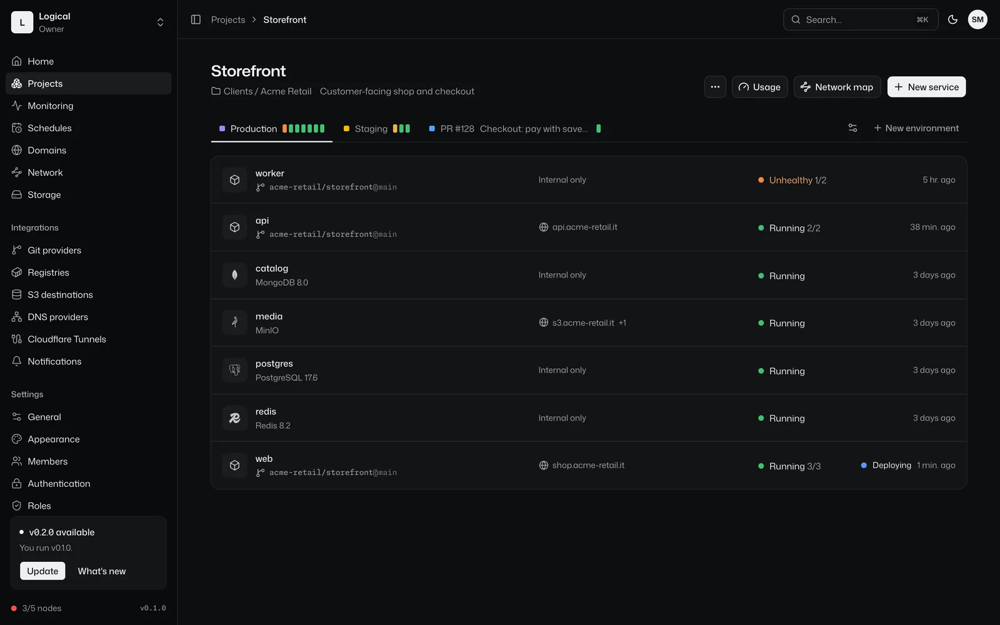
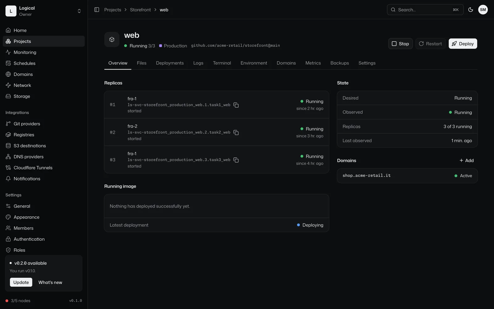
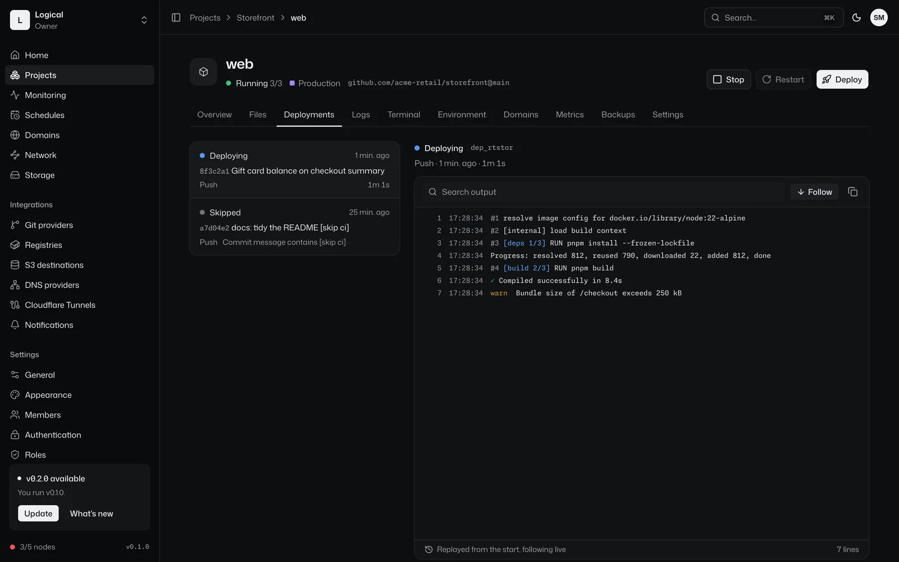
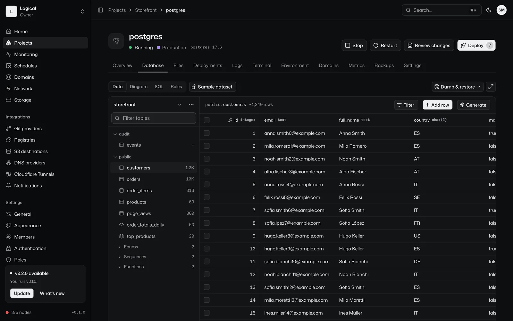
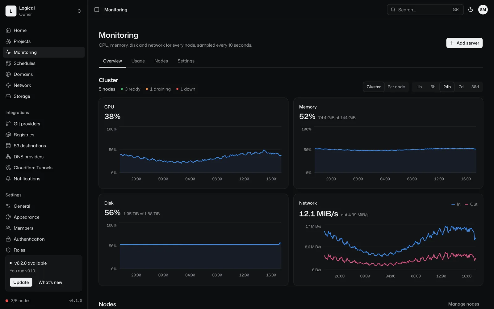
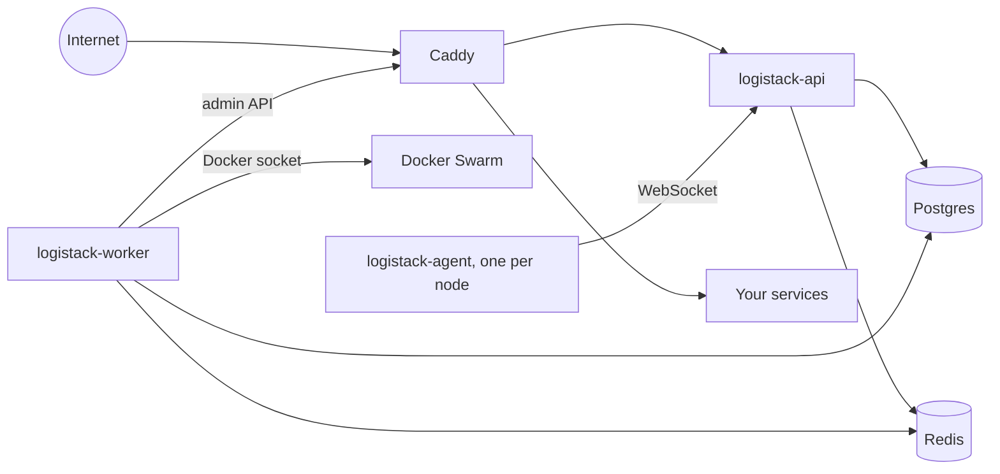

# LogiStack

LogiStack is an open-source, self-hosted PaaS on Docker Swarm, an alternative to Dokploy and Coolify. Push code or pick an image: LogiStack builds it, deploys it with zero downtime, gives it a domain with HTTPS, and backs up its data, on servers you own.

It is built around a few rules instead of shell scripts. Postgres holds the desired state and a reconciler converges Docker and Caddy to it, so a manual change on a server is reverted instead of drifting. Docker is driven through its Engine API, never a shell string. Cleanup only touches objects LogiStack labeled. And no feature is behind a license: SSO, the audit log, custom roles and multi-node clusters are all in the Apache 2.0 build.

[Documentation](https://stack.logicaltech.it/docs/) · [Security model](https://stack.logicaltech.it/docs/reference/security-model/) · [Migrate from Dokploy or Coolify](https://stack.logicaltech.it/docs/operations/migrate-in-ten-minutes/) · [Releases](https://github.com/logical-tech/logistack/releases)



## Try it in 60 seconds

On a fresh Ubuntu 22.04+ or Debian 12+ server with 2 GB of RAM, run:

```sh
curl -fsSL https://stack.logicaltech.it/install.sh | sudo bash -s -- --public-setup
```

The installer installs Docker if it is missing, initialises Swarm, creates the secrets and deploys the stack. Most of its few minutes go to pulling images. It ends with a link that carries a one-time setup token:

```text
http://203-0-113-7.sslip.io/setup#token=Qm9yZWQ...
```

Open it and the setup wizard asks for the owner account, the organization, the domain for your services and a Let's Encrypt email. The token sits in the URL fragment, so your browser never sends it to a server log, and it stops working once the owner exists. A bot that finds the server first cannot claim it.

Without `--public-setup`, setup stays private on `127.0.0.1:3000` and you reach it through an SSH tunnel (`ssh -L 3000:127.0.0.1:3000 root@<server>`). To see the plan without changing anything, add `--dry-run`.

Requirements: amd64 or arm64, 2 GB of RAM, 10 GB of free disk, and ports 80/tcp, 443/tcp and 443/udp open. `/etc/logistack/credentials` holds the master key that encrypts every stored secret: back it up. The [install guide](https://stack.logicaltech.it/docs/getting-started/install/) covers every flag and how to pick a domain.

<table>
<tr>
<td></td>
<td></td>
</tr>
<tr>
<td></td>
<td></td>
</tr>
</table>

## Features

| Area | What LogiStack does |
| --- | --- |
| Sources | GitHub App, GitLab, Gitea, Bitbucket, any git URL, or a container image. Deploy on push, filtered by watch paths, with preview environments for pull requests. |
| Builds | Dockerfile, railpack or static, built by rootless BuildKit for amd64 and arm64. Images are tagged by deployment id, never `:latest`. |
| Deployments | Start-first rolling updates, health checks, autoscaling, rollback to any earlier deployment, cancel. |
| Templates | Hundreds of one-click apps, and any Compose file as a stack. |
| Databases | Postgres, MySQL, MariaDB, MongoDB, Redis and libSQL, each with a built-in editor. |
| Domains | Automatic HTTPS over HTTP-01 or DNS-01, wildcard and custom certificates, redirects, basic auth, Cloudflare Tunnels and Tailscale. |
| Backups | Databases and volumes to S3, SFTP, WebDAV and more, with retention, scheduled restore checks and restore. |
| Servers | Add nodes from the dashboard over SSH. An agent on every node streams logs and metrics and runs backups and schedules where the data lives. |
| Observability | Metrics, logs, log drains, alerts to email, Slack, Discord, Telegram, Teams and more, and image vulnerability scanning. |
| Access | Organizations, folders, projects and environments. Built-in and custom roles per scope. Passkeys, TOTP, OIDC and SAML. Append-only audit log. |
| Automation | REST API with OpenAPI, scoped API keys, service accounts, project manifests, and an MCP server at `/mcp`. |
| Updates | One click from the dashboard on the stable, beta or nightly channel, with the changelog and its breaking changes shown first, and automatic rollback. |

## How it compares

LogiStack learned a lot from Dokploy and Coolify, and both have much larger communities. The table shows the design choices that differ, as of November 2026.

| | LogiStack | Dokploy | Coolify |
| --- | --- | --- | --- |
| License | Apache 2.0, every feature | Apache 2.0, with SSO, audit logs, custom roles and whitelabel under the proprietary DSAL since January 2026 | Apache 2.0, every feature |
| Talks to Docker through | The Engine API; other tools with argv lists | Shell commands on the host | Shell commands over SSH |
| Proxy | Caddy, configured through its admin API without reloads | Traefik | Traefik or Caddy |
| Multi-node | Docker Swarm, with an agent per node | Docker Swarm | Swarm support deprecated; the announced v5 drops it |
| GitHub security advisories, last 12 months | None published yet | About 55 | 61, 16 critical |

Most advisories against the other two are root command injection through shell strings and cross-tenant authorization flaws; the [security model](https://stack.logicaltech.it/docs/reference/security-model/) explains how LogiStack's rules target both, with links to both advisory lists. LogiStack is younger and has had far fewer eyes on it, so "none published yet" is not a claim that it has no bugs.

## Migrate from Dokploy or Coolify

Install LogiStack on the same server. It finds Dokploy or Coolify v4, leaves its proxy on ports 80 and 443, and Home offers **Start migration**. The wizard reads the old platform, imports projects, apps, Compose files, databases, domains and settings, moves services one at a time with a rollback for each, then switches traffic. Databases keep their volumes and hostnames. Read the [ten-minute guide](https://stack.logicaltech.it/docs/operations/migrate-in-ten-minutes/).

## Install next to an existing proxy

If another proxy holds ports 80 and 443, for example the Traefik of a Dokploy install, run the installer with `--no-ingress`:

```sh
curl -fsSL https://stack.logicaltech.it/install.sh | sudo bash -s -- --no-ingress
```

Caddy stays at zero tasks, and the API listens on `127.0.0.1:3000` on the server only. Open an SSH tunnel from your machine, then open `http://localhost:3000` to run the setup:

```sh
ssh -L 3000:127.0.0.1:3000 root@<server-ip>
```

If port 3000 is taken on the server, set `LOGISTACK_TUNNEL_PORT=<port>` before you run the installer. A plain re-run keeps ingress off. When ports 80 and 443 are free, turn Caddy on:

```sh
curl -fsSL https://stack.logicaltech.it/install.sh | sudo bash -s -- --enable-ingress
```

## Upgrade

In the dashboard, an admin opens **Settings > Updates**, picks the stable, beta or nightly channel, reads the changelog of every release the update crosses, breaking changes first, and clicks **Update to vX**. The worker pulls every image first and changes nothing if a pull fails. It lets running deployments and backups finish, migrates the database once, then updates the api, the agent, Caddy, and the worker last, waiting for each to turn healthy. A service that does not turn healthy rolls back, and so does every service updated before it. Progress streams live on the page. With **Check daily** on, LogiStack asks GitHub once a day and sends `instance.update_available` to your notification channels.

From the server, run the installer with a release, or `latest`:

```sh
curl -fsSL https://stack.logicaltech.it/install.sh | sudo bash -s -- --version 0.2.0
```

This is also how an install built with `--local-build` moves to the published images. An in-app update swaps only images, so a release that changes `install/stack.yml` says so in its notes and needs this command. A plain re-run keeps the release that runs now and never rotates existing secrets.

## Uninstall

```sh
curl -fsSL https://raw.githubusercontent.com/logical-tech/logistack/main/install/uninstall.sh | sudo bash
```

`uninstall.sh` removes the stack and its networks. Volumes, secrets, and `/etc/logistack` stay, so the installer brings LogiStack back with its data. To delete everything, including the database, run it with `-s -- --purge`. It asks you to type `purge`. Docker and Swarm stay installed.

[The installer reference](https://stack.logicaltech.it/docs/reference/installer/) covers every installer flag, the objects the installer creates, firewall rules for more nodes, and how to build the images.

## Architecture



The api (`apps/server`) serves the REST API, the WebSocket, webhooks, and the dashboard (`apps/web`). It writes the desired state to Postgres and queues jobs in Redis. The worker (`apps/worker`) runs those jobs: clone, build, deploy, back up. Its reconciler compares Postgres with Docker and Caddy and fixes the difference. Pure compilers turn a service row into a Docker service spec and the domain list into Caddy JSON. The agent (`apps/agent`) runs on every node and dials the api. It streams logs and metrics and runs node-local jobs. Postgres, Redis, and the Caddy admin API sit on the `ls-control` network, which your services cannot reach.

`docs/DOMAIN.md` describes the data model. `docs/PIANO.md` is the design document, in Italian.

## Development

You need Bun 1.4 and Docker. Start Postgres on port 5433 and Redis on port 6380, then apply the migrations:

```sh
bun install
cp .env.example .env
bun run dev:infra
bun packages/db/src/migrate.ts
```

Run each process in its own terminal, from the repository root so Bun loads `.env`:

```sh
bun --watch apps/server/src/index.ts
bun --watch apps/worker/src/index.ts
bun run --filter @logistack/web dev
```

The dashboard runs on `http://localhost:5173` and proxies `/api` to the API on port 3000.

Run `bun run check` before you commit. It runs `typecheck`, `biome check .`, and `bun test`. Integration tests need Docker with an active single-node Swarm, and skip when `docker info` fails. A test that creates Docker objects names them `ls-test-<area>-*`, labels them `logistack.test=<area>`, and cleans up by that exact prefix only. `CONTRIBUTING.md` has the rest.

## Security

Report vulnerabilities privately, as `SECURITY.md` describes. Do not open a public issue.

## License

Apache-2.0. See `LICENSE` and `NOTICE`.

## Acknowledgements

Dokploy and Coolify shaped many of LogiStack's ideas. Some service templates are adapted from the Coolify templates (Apache-2.0) and the Dokploy templates (MIT). `NOTICE` lists the attribution.
