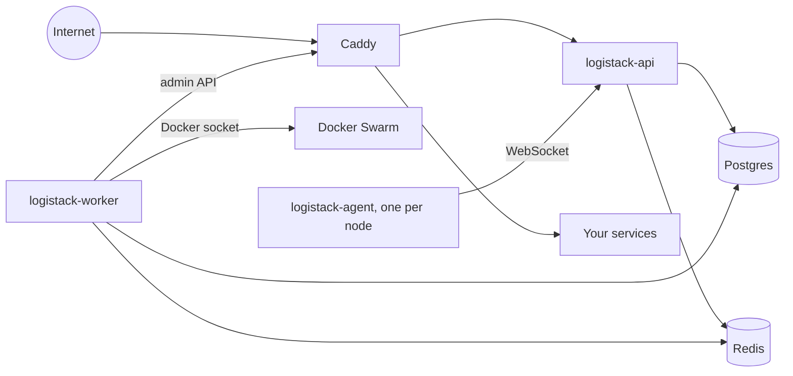

# LogiStack

LogiStack is a self-hosted PaaS that runs on Docker Swarm, an alternative to Dokploy and Coolify. You push code or pick an image, and LogiStack builds it, deploys it, gives it a domain with HTTPS, and backs up its data. It differs from those two in four ways. Postgres holds the desired state, and a reconciler converges Docker and Caddy to it, so a manual change on the server is reverted instead of drifting. The worker configures Caddy through its admin API, so a domain change never redeploys the app or restarts the proxy. An agent on every node collects logs and metrics, and runs backups and schedules on the node where the container lives. No feature is behind a license: audit log, custom roles, SSO, and multi-node are all in the open-source build.

Documentation, with step-by-step guides and screenshots: https://stack.logicaltech.it/docs/

## Quick start

Run the installer as root on a fresh server:

```sh
curl -fsSL https://raw.githubusercontent.com/logical-tech/logistack/main/install/install.sh | sudo bash
```

The installer installs Docker if it is missing, initialises Swarm, creates the secrets, deploys the stack, and prints a URL such as `http://203-0-113-7.sslip.io`. Open it to finish the setup in the browser. To see the plan without changing anything, add `-s -- --dry-run` after `bash`.

Requirements:

- Ubuntu 22.04 or later, or Debian 12 or later. Other distributions with Docker 26 or later work, but the installer warns that they are untested.
- amd64 or arm64, at least 2 GB of RAM, and 10 GB of free disk.
- Ports 80/tcp, 443/tcp, and 443/udp free on the server and open in your provider's firewall.

The guided setup asks for these, in order:

1. The owner account: name, email, and password.
2. The organization name.
3. The domain that service hostnames live under, and the dashboard URL.
4. A DNS check, when you chose your own domain.
5. The email address Let's Encrypt sends certificate notices to.
6. Whether to run a local registry for images built from your repositories.

`/etc/logistack/credentials` holds the master key that encrypts every stored secret. Back it up. Docker secrets cannot be read back.

### Pick a domain

Use a wildcard domain you control, such as `*.srv1.example.com`. Create two A records, `*.srv1.example.com` and `srv1.example.com`, that point at the server. If your DNS is on Cloudflare, Route 53, or Hetzner, give the wizard an API token. LogiStack then creates the records and requests one wildcard certificate over DNS-01, so a new service gets HTTPS without a new certificate request. Without a token, Caddy requests a certificate per hostname over HTTP-01.

For a quick start, pick sslip.io or nip.io. A hostname such as `app.203-0-113-7.sslip.io` resolves to the server with no DNS setup. These domains are not on the Public Suffix List, so every sslip.io user on the internet shares one Let's Encrypt limit of 50 certificates per week. Certificate requests can fail for reasons outside your control. Move to your own domain before you rely on the server.

## Install next to an existing proxy

If another proxy holds ports 80 and 443, for example the Traefik of a Dokploy install, run the installer with `--no-ingress`:

```sh
curl -fsSL https://raw.githubusercontent.com/logical-tech/logistack/main/install/install.sh | sudo bash -s -- --no-ingress
```

Caddy stays at zero tasks, and the API listens on `127.0.0.1:3000` on the server only. Open an SSH tunnel from your machine, then open `http://localhost:3000` to run the setup:

```sh
ssh -L 3000:127.0.0.1:3000 root@<server-ip>
```

If port 3000 is taken on the server, set `LOGISTACK_TUNNEL_PORT=<port>` before you run the installer. A plain re-run keeps ingress off. When ports 80 and 443 are free, turn Caddy on:

```sh
curl -fsSL https://raw.githubusercontent.com/logical-tech/logistack/main/install/install.sh | sudo bash -s -- --enable-ingress
```

## Migrate from Dokploy

The importer reads Dokploy's compose directories and creates one LogiStack project per compose, with its env vars and domains. It writes through the API's own routes, so validation, permission checks, and audit entries apply. It maps single-service composes that use an image. It refuses `build:`, several services, and named volumes, and lists the reason. A re-run skips services it already imported.

On the server, copy Dokploy's compose directory into the API container and run a dry run first:

```sh
api=$(docker ps -q --filter name=logistack_logistack-api | head -n1)
docker cp /etc/dokploy/compose "$api":/import
docker exec -it "$api" /app/install/entrypoint.sh \
	bun apps/server/scripts/import-dokploy.ts --source /import --org <org-slug> --dry-run
```

Run it again without `--dry-run` to create the services. Other options:

| Flag | Effect |
| --- | --- |
| `--folder <name>` | Folder for the new projects. Defaults to `Imported from Dokploy`. |
| `--deploy` | Queue a deployment of every imported service. |
| `--stopped <appName,...>` | Create these services with desired state stopped. |
| `--allow-sensitive` | Allow bind mounts of sensitive host paths. |
| `--dokploy-db <url>` | Read project and compose names from Dokploy's Postgres instead of folder names. |

Remove the copy when you are done, because the `.env` files hold secrets:

```sh
docker exec -u root "$api" rm -rf /import
```

## Upgrade

In the dashboard, an admin opens **Settings > Updates**, reads the notes of the latest release, and clicks **Update to vX**. The worker pulls every image first and changes nothing if a pull fails. It then updates the api, which runs database migrations at startup under a Postgres advisory lock, waits for it to turn healthy, and then updates the agent, Caddy, and the worker last. A service that does not turn healthy rolls back, and so does every service updated before it. Progress streams live on the page. With **Check daily** on, LogiStack asks GitHub once a day and sends `instance.update_available` to your notification channels.

From the server, run the installer with a release, or `latest`:

```sh
curl -fsSL https://raw.githubusercontent.com/logical-tech/logistack/main/install/install.sh | sudo bash -s -- --version 0.2.0
```

This is also how an install built with `--local-build` moves to the published images. An in-app update swaps only images, so a release that changes `install/stack.yml` says so in its notes and needs this command. A plain re-run keeps the release that runs now and never rotates existing secrets.

## Uninstall

```sh
curl -fsSL https://raw.githubusercontent.com/logical-tech/logistack/main/install/uninstall.sh | sudo bash
```

`uninstall.sh` removes the stack and its networks. Volumes, secrets, and `/etc/logistack` stay, so the installer brings LogiStack back with its data. To delete everything, including the database, run it with `-s -- --purge`. It asks you to type `purge`. Docker and Swarm stay installed.

[The installer reference](https://stack.logicaltech.it/docs/reference/installer/) covers every installer flag, the objects the installer creates, firewall rules for more nodes, and how to build the images.

## Features

| Area | What LogiStack does |
| --- | --- |
| Sources | GitHub App, GitLab, Gitea, Bitbucket, any git URL, or a container image. Deploy on push, filtered by watch paths. |
| Builds | Dockerfile, railpack, or static, built by rootless BuildKit. Images are tagged by deployment id, never `:latest`. |
| Deployments | Start-first rolling updates, health checks, rollback to an earlier deployment, cancel. |
| Databases | Postgres, MySQL, MariaDB, MongoDB, Redis. |
| Domains | Automatic HTTPS from Let's Encrypt over HTTP-01 or DNS-01, wildcard certificates, custom certificates, redirects. |
| Backups | Databases and volumes to any S3-compatible storage, with retention, scheduled restore checks, and restore. |
| Schedules | Cron jobs in an ephemeral container, inside a service, or on a node. |
| Servers | Add nodes from the dashboard over SSH. Per-node metrics and logs from the agent. |
| Notifications | Email, Slack, Discord, Telegram, Teams, Mattermost, ntfy, Gotify, Pushover, webhook. |
| Access | Organizations, folders, projects, and environments. Built-in and custom roles per scope. Passkeys, TOTP, OIDC, and SAML. |
| Automation | REST API with OpenAPI, scoped API keys, machine accounts, and an MCP server at `/mcp`. |
| Audit | Append-only audit log with the actor, the outcome, and a diff with secrets redacted. |

## Architecture



The api (`apps/server`) serves the REST API, the WebSocket, webhooks, and the dashboard (`apps/web`). It writes the desired state to Postgres and queues jobs in Redis. The worker (`apps/worker`) runs those jobs: clone, build, deploy, back up. Its reconciler compares Postgres with Docker and Caddy and fixes the difference. Pure compilers turn a service row into a Docker service spec and the domain list into Caddy JSON. The agent (`apps/agent`) runs on every node and dials the api. It streams logs and metrics and runs node-local jobs. Postgres, Redis, and the Caddy admin API sit on the `ls-control` network, which your services cannot reach.

`docs/DOMAIN.md` describes the data model. `docs/PIANO.md` is the design document, in Italian.

## Development

You need Bun 1.4 and Docker. Start Postgres on port 5433 and Redis on port 6380, then apply the migrations:

```sh
bun install
cp .env.example .env
bun run dev:infra
bun packages/db/src/migrate.ts
```

Run each process in its own terminal, from the repository root so Bun loads `.env`:

```sh
bun --watch apps/server/src/index.ts
bun --watch apps/worker/src/index.ts
bun run --filter @logistack/web dev
```

The dashboard runs on `http://localhost:5173` and proxies `/api` to the API on port 3000.

Run `bun run check` before you commit. It runs `typecheck`, `biome check .`, and `bun test`. Integration tests need Docker with an active single-node Swarm, and skip when `docker info` fails. A test that creates Docker objects names them `ls-test-<area>-*`, labels them `logistack.test=<area>`, and cleans up by that exact prefix only. `CONTRIBUTING.md` has the rest.

## Security

Report vulnerabilities privately, as `SECURITY.md` describes. Do not open a public issue.

## License

Apache-2.0. See `LICENSE` and `NOTICE`.

## Acknowledgements

Dokploy and Coolify shaped many of LogiStack's ideas. Some service templates are adapted from the Coolify templates (Apache-2.0) and the Dokploy templates (MIT). `NOTICE` lists the attribution.
